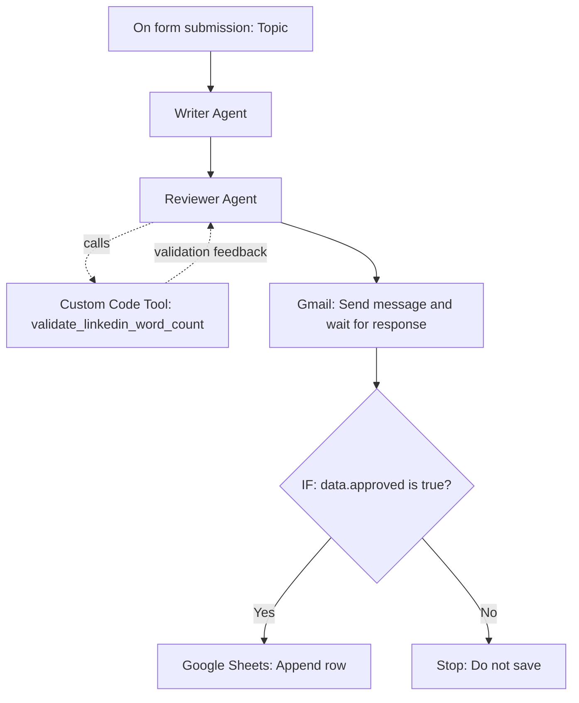

# LinkedIn Post Approval Workflow using n8n and AI Agents

An AI-assisted LinkedIn content review and approval workflow built in **n8n**. A user submits a topic through an n8n form, a Writer Agent drafts a post, and a Reviewer Agent improves it and checks formatting through a custom JavaScript tool. The reviewed post is sent by Gmail for human approval. **Only approved posts are saved to Google Sheets.**

> **Scope:** This workflow prepares and approves LinkedIn content; it does **not** automatically publish to LinkedIn.

## Workflow overview



### Components

| Node / Tool | Purpose |
| --- | --- |
| **On form submission** | Collects a required `Topic*` field. |
| **Writer Agent** | Drafts a professional LinkedIn post with a heading, body, call to action, and hashtags. Uses an OpenAI chat model; the configured workflow also includes Simple Memory and Google Search via SerpAPI. |
| **Reviewer Agent** | Edits the draft for clarity, tone, structure, and technical accuracy. Uses an OpenAI chat model and the custom word-count tool. |
| **`validate_linkedin_word_count`** | JavaScript Custom Code Tool that checks the heading, body word count, and hashtag count, and returns structured validation feedback. |
| **Gmail — Send message and wait for response** | Emails the reviewed post with **Approve** and **Reject** buttons and waits for a response. |
| **IF** | Checks the Gmail response's `data.approved` Boolean value. |
| **Google Sheets — Append row** | Saves approved content in the sheet. Rejected content is not saved. |

## Content requirements

- Professional heading of **5–10 words**.
- Post body of **120–150 words**, excluding heading and hashtags.
- A clear call to action (CTA).
- No more than **3 hashtags**.
- Professional, readable writing with technically accurate claims.
- Final Reviewer Agent output uses this format:

```text
Heading: A Professional Heading About the Topic

Post:
The reviewed LinkedIn post body goes here...

#Example #LinkedIn #AI
```

The Reviewer Agent is prompted to call `validate_linkedin_word_count`, revise an invalid draft, and validate again (up to three validation calls). **This is agent-directed validation, not an independent hard gate**: the current workflow does not have a separate IF node checking the validation tool before Gmail.

## Word-count validation tool

Attach a **Custom Code Tool** to the Reviewer Agent and name it `validate_linkedin_word_count`. Set the language to **JavaScript** and leave **Specify Input Schema** disabled if using the tool's default `query` input.

```javascript
const text = String(query ?? "").trim();

const headingMatch = text.match(/^Heading:[ \t]*(.+)$/im);
const postMatch = text.match(/^Post:[ \t]*([\s\S]*)/im);

const heading = headingMatch?.[1]?.trim() ?? "";
const post = postMatch?.[1]?.trim() ?? "";

const body = post.replace(/#[\p{L}\p{N}_]+/gu, "").trim();
const wordCount = body ? body.split(/\s+/).filter(Boolean).length : 0;
const headingWordCount = heading ? heading.split(/\s+/).length : 0;
const hashtagCount = (post.match(/#[\p{L}\p{N}_]+/gu) ?? []).length;

const errors = [];
if (!heading) errors.push("Heading is missing");
if (!post) errors.push("Post is missing");
if (headingWordCount < 5 || headingWordCount > 10) {
  errors.push("Heading must contain 5-10 words");
}
if (wordCount < 120 || wordCount > 150) {
  errors.push(`Post contains ${wordCount} words. Required: 120-150.`);
}
if (hashtagCount > 3) errors.push("Maximum 3 hashtags allowed");

return JSON.stringify({
  valid: errors.length === 0,
  word_count: wordCount,
  heading_word_count: headingWordCount,
  hashtag_count: hashtagCount,
  errors,
  instruction: errors.length === 0
    ? "VALID: Return this reviewed post."
    : "INVALID: Rewrite the post and call this tool again."
});
```

**Note:** The validator checks formatting and counts; it does not independently verify technical facts. The Reviewer Agent is responsible for editorial accuracy.

## Gmail approval configuration

Configure the Gmail node to **Send message and wait for response**:

- **Response type:** Approval
- **Approval choices:** Approve and Disapprove (button labels: Approve / Reject)
- **Message:** Reviewer Agent's final output
- **Wait limit used in testing:** 1 day

Example expression for the message:

```javascript
{{ $('Reviewer Agent').first().json.output }}
```

Configure the downstream IF node with a **Boolean → is true** condition:

```javascript
{{ $json.data.approved }}
```

- **True:** Append the approved post to Google Sheets.
- **False:** End the workflow without appending a row.

## Google Sheets setup

Create a sheet with these exact columns:

| Date | Topic | Final Post | Status |
| --- | --- | --- | --- |
| 2026-10-23 | MCP Helps lot in AI Agen | Enhancing AI Agent Efficiency with MCP ... | Approved |

Configure the **Append row in sheet** node:

| Column | n8n expression / value |
| --- | --- |
| Date | `{{ $now.toFormat('yyyy-MM-dd') }}` |
| Topic | `{{ $('On form submission').first().json['Topic*'] }}` |
| Final Post | `{{ $('Reviewer Agent').first().json.output.replace(/^Heading:\s*/i, '').replace(/\n\s*Post:\s*/i, '\n\n').trim() }}` |
| Status | `Approved` |

The **Topic** column preserves the original submitted topic. The **Final Post** column saves the reviewed heading and content without the literal `Heading:` and `Post:` labels.

## How to run

1. Import the exported n8n workflow JSON into your n8n instance.
2. Configure credentials for the OpenAI chat model, Gmail, Google Sheets, and SerpAPI (if you keep the Writer Agent's search tool).
3. Select the correct Google Sheets document and sheet, and ensure the four columns above exist.
4. Check the form field name (`Topic*`), Reviewer Agent prompt, validation tool, Gmail recipient, and IF condition.
5. Run or activate the workflow as appropriate for your n8n form trigger.
6. Submit a topic using the form.
7. Review the Gmail message and click **Approve** or **Reject**.
8. Confirm that an approved post is appended to Google Sheets and a rejected post is not.

Do not commit OAuth tokens, API keys, `.env` files, or real credential values to GitHub. Exported n8n workflow files may contain configuration metadata; inspect the JSON before publishing it.

## Tested behavior

The following behaviors were observed during testing:

| Test | Observed result |
| --- | --- |
| Submit a topic | Writer and Reviewer Agents executed. |
| Reviewer calls validation tool | Tool executed and returned validation feedback. |
| Word-count validation | `valid: true`, `word_count: 122`, `heading_word_count: 6`, `hashtag_count: 3`, `errors: []`. |
| Approve via Gmail | `data.approved: true`; Google Sheets append succeeded. |
| Reject via Gmail | `data.approved: false`; IF followed the false branch, with no Google Sheets append. |
| Sheet formatting | Original topic and clean reviewed post were saved with status `Approved`. |

The successful test confirms **one valid tool invocation**. An invalid-post rewrite cycle has not yet been demonstrated by the shared execution results.

## Suggested repository structure

```text
linkedin-post-approval/
├── README.md
├── workflow/
│   └── linkedin-post-approval.json
└── screenshots/
    ├── 01-workflow.png
    ├── 02-reviewer-validation.png
    ├── 03-gmail-approval.png
    └── 04-google-sheets-approved.png
```

Add your exported workflow JSON and your own screenshots to these folders before submitting the assignment.

## Screenshots and demonstration

For the assignment submission, capture:

1. The full n8n workflow canvas.
2. The Reviewer Agent's custom word-count tool and validation result.
3. The Gmail approval email with Approve and Reject buttons.
4. The IF node's approved and rejected execution branches.
5. The Google Sheets row created after approval.

Also record a short walkthrough of the form submission, agent review, approval decision, and resulting sheet entry, then share it using your course's submission process.

## Potential improvements

- Add an independent validation IF gate before Gmail so an unvalidated or `VALIDATION_FAILED` post cannot be emailed for approval.
- Demonstrate the rewrite behavior using a deliberately short draft and confirm a second tool call.
- Add error handling for API failures and approval timeouts.
- Optionally add LinkedIn publishing **after** explicit approval, with separate credentials and permissions. Publishing is not part of the workflow described here.

## Technology stack

- **n8n** (self-hosted, version 2.43.6 used in testing)
- **OpenAI chat models** for Writer and Reviewer Agents
- **JavaScript Custom Code Tool** for validation
- **Gmail** for human approval
- **Google Sheets** for approved-post storage
- **SerpAPI Google Search** for Writer Agent research

## Project status

**Working:** Topic submission, drafting, review, tool-based validation, Gmail approval/rejection, and Google Sheets storage of approved posts.

**Not yet implemented:** Independent validation gate before Gmail and automatic LinkedIn publishing.
